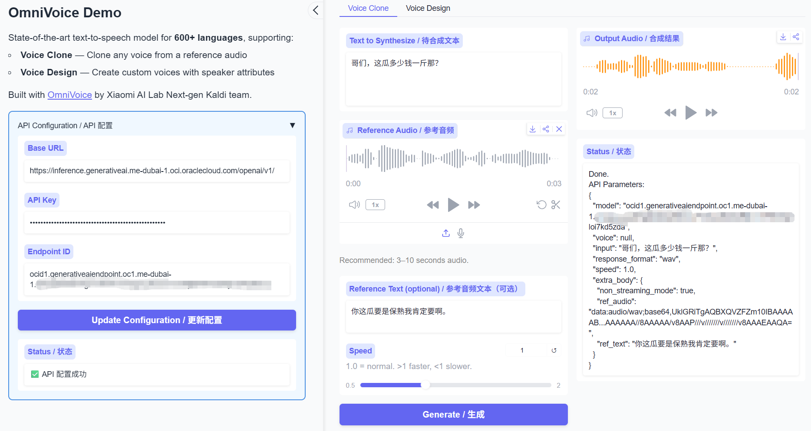
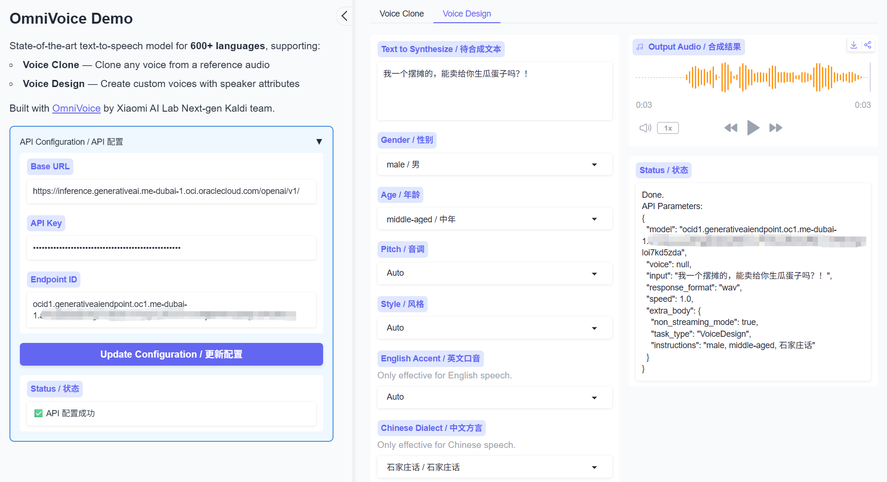

# OmniVoice OCI Demo 🌍

<p align="center">
  
</p>

<p align="center">
  <a href="https://huggingface.co/k2-fsa/OmniVoice"></a>
  &nbsp;
  <a href="https://arxiv.org/abs/2604.00688"></a>
  &nbsp;
  <a href="https://zhu-han.github.io/omnivoice"></a>
</p>

This is a simplified demo UI for [OmniVoice](https://github.com/k2-fsa/OmniVoice) that connects to **Oracle Cloud Infrastructure (OCI) Generative AI** service via OpenAI-compatible API. OmniVoice is a state-of-the-art massively multilingual zero-shot text-to-speech (TTS) model supporting over 600 languages.

## What is this project?

This is a **simplified web interface** designed to work with OmniVoice models imported into OCI Generative AI. It provides an easy-to-use Gradio-based UI for voice cloning and voice design without requiring local model deployment.

## Difference from Source Repository

- Simplified demo UI only
- Designed for remote inference via OCI Generative AI
- No local model training or evaluation
- Minimal dependencies and simple setup
- Focus on easy voice generation through web interface

**Contents**: [Key Features](#key-features) | [Installation](#installation) | [Quick Start](#quick-start) | [Usage](#usage) | [OCI Documentation](#oci-documentation) | [Citation](#citation)

## Key Features

- **600+ Languages Supported**: The broadest language coverage among zero-shot TTS models ([full list](docs/languages.md)).
- **Voice Cloning**: State-of-the-art voice cloning quality.
- **Voice Design**: Control voices via assigned speaker attributes (gender, age, pitch, dialect/accent, whisper, etc.).
- **OCI Integration**: Connect to Oracle Cloud Infrastructure Generative AI service.
- **Simple UI**: Clean Gradio-based interface for easy voice generation.
- **Remote Inference**: No local GPU required, everything runs on OCI.

## Installation

```bash
# Install using uv (recommended)
uv sync

# Or install using pip
pip install -r requirements.txt
pip install -e .
```

## Quick Start

Launch the demo UI:

```bash
# Start using uv (recommended)
uv run omnivoice-demo --ip 0.0.0.0 --port 8001

# Or start using pip
python -m omnivoice.demo --ip 0.0.0.0 --port 8001
```

Then open your browser to `http://localhost:8001` and configure your API settings:

1. **Base URL**: Your inference server's base URL (default: OCI Generative AI)
2. **API Key**: Your API authentication key
3. **Endpoint ID**: Your specific endpoint ID for the OmniVoice model

Once configured, you can use the demo for:
- **Voice Clone**: Upload reference audio and clone voices
- **Voice Design**: Create custom voices with speaker attributes

## Usage

### API Configuration

The demo requires configuration of your remote inference server:

1. **Base URL**: The base URL of your inference server
   - Default: `https://inference.generativeai.us-chicago-1.oci.oraclecloud.com/openai/v1/`
   - Can be changed to any OpenAI-compatible endpoint

2. **API Key**: Your authentication key for the inference service

3. **Endpoint ID**: The specific endpoint ID for the OmniVoice model

#### OCI Documentation

This demo is designed to work with Oracle Cloud Infrastructure Generative AI service. For more information on:

- **Managing Imported Models**: [Documentation](https://docs.oracle.com/en-us/iaas/Content/generative-ai/manage-imported-models.htm)
- **Compatible K2-FSA OmniVoice Models**: [Documentation](https://docs.oracle.com/en-us/iaas/Content/generative-ai/imported-k2-fsa-models.htm)
- **API Key Management**: [Documentation](https://docs.oracle.com/en-us/iaas/Content/generative-ai/api-keys.htm)
- **Managing Model Endpoints**: [Documentation](https://docs.oracle.com/en-us/iaas/Content/generative-ai/endpoint.htm)
- **OCI OpenAI-Compatible Endpoints**: [Documentation](https://docs.oracle.com/en-us/iaas/Content/generative-ai/openai-compatible-api.htm)

### Voice Cloning



1. Switch to the "Voice Clone" tab
2. Enter the text you want to synthesize
3. Upload a reference audio file (3-10 seconds recommended)
4. Optionally provide the reference text transcription
5. Click "Generate" to create the cloned voice

### Voice Design



1. Switch to the "Voice Design" tab
2. Enter the text you want to synthesize
3. Select speaker attributes from the dropdowns:
   - Gender (Male/Female)
   - Age (Child to Elderly)
   - Pitch (Very Low to Very High)
   - Style (Whisper)
   - English Accent (various options)
   - Chinese Dialect (various options)
4. Click "Generate" to create the designed voice

---

## Community Projects

OmniVoice is supported by a growing ecosystem of community projects.
Explore them in [Community Projects](docs/community-projects.md).

---

## Citation

```bibtex
@article{zhu2026omnivoice,
      title={OmniVoice: Towards Omnilingual Zero-Shot Text-to-Speech with Diffusion Language Models},
      author={Zhu, Han and Ye, Lingxuan and Kang, Wei and Yao, Zengwei and Guo, Liyong and Kuang, Fangjun and Han, Zhifeng and Zhuang, Weiji and Lin, Long and Povey, Daniel},
      journal={arXiv preprint arXiv:2604.00688},
      year={2026}
}
```

---

## Disclaimer

Users are strictly prohibited from using this model for unauthorized voice cloning, voice impersonation, fraud, scams, or any other illegal or unethical activities. All users shall ensure full compliance with applicable local laws, regulations, and ethical standards. The developers assume no liability for any misuse of this model and advocate for responsible AI development and use, encouraging the community to uphold safety and ethical principles in AI research and applications.
